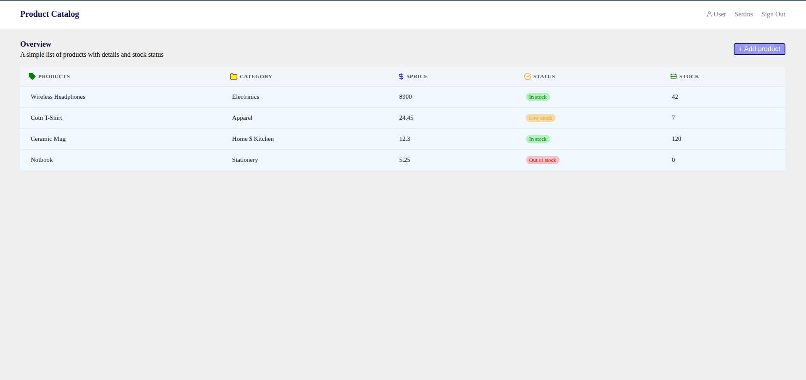
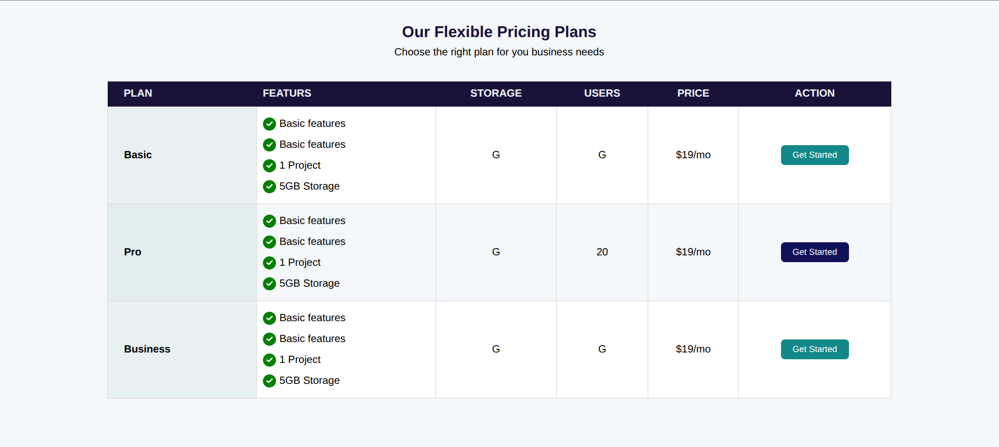

# Intermediant html & css

This is the web page combining the both kowledge of how to make table and thier data and how to create your own SVG icon and use it in your project. In addition it contain the technics and how to style using css advances and css function.

## Languages used
* HTML
* CSS
- I will you other called javascript after

## How to run it ?
These are the following steps of runing this page:
- Clone my repository
- Install liveserver extention in your vs code
- Go to index.html - right click - choose liveserver - then you will show it on the browser

Other method to run it click to this link [click here =>](https://gedeotwiz.github.io/intermediant-htl-css/)

## Screenshot

## Contributor
 - Twizerimana Gedeon